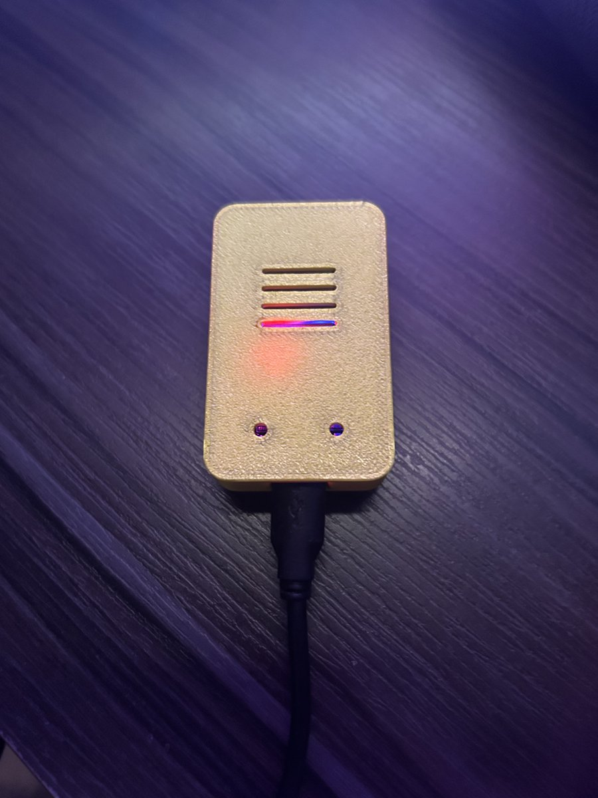

# esp32-wake-on-lan

Turn on a PC from anywhere with one tap on an iPhone, using a cheap ESP32 sitting on the home network.



```
iPhone (Shortcuts) --HTTP POST--> Adafruit IO <--MQTT/TLS-- ESP32 --magic packet--> PC
                   <--HTTP GET---  status feed <--publish--  (pings the PC every 15 s)
```

## How it works

- The ESP32 stays on at home, connected to Wi-Fi, and subscribes to an [Adafruit IO](https://io.adafruit.com) feed over MQTT with TLS.
- An iPhone Shortcut posts a command to that feed. The ESP32 receives it and sends a Wake-on-LAN magic packet on the local network.
- The ESP32 also pings the PC and publishes `online` / `offline` to a second feed, so the Shortcut can confirm the PC is up.
- Everything is outbound from the house: it works behind CGNAT and needs no port forwarding.
- The board's BOOT button sends the magic packet too, which is useful to test the local part on its own.

## Hardware

- ESP32 DevKit (WROOM-32, 30 pins, micro-USB)
- Any 5 V USB charger
- PC connected by **cable** with a fixed IP (Wake-on-LAN over Wi-Fi is unreliable on desktops)
- Optional: 3D-printed case (see [case/](case/))

## Setup

1. **Prepare the PC** for Wake-on-LAN (BIOS + network card): see [docs/pc-setup.md](docs/pc-setup.md).
2. **Create the Adafruit IO feeds** `pc-command` and `pc-status` (free plan is enough).
3. **Configure the firmware**: copy `firmware/esp32-wake-on-lan/secrets.example.h` to `secrets.h` and fill it in.
4. **Install the libraries** in the Arduino IDE: *Adafruit MQTT Library* and *ESP32Ping*.
5. **Flash** with the board set to *ESP32 Dev Module*.
6. **Create the iPhone Shortcut**: see [docs/ios-shortcut.md](docs/ios-shortcut.md).

Test in this order: BOOT button wakes the PC → command from the Adafruit IO dashboard wakes the PC → Shortcut wakes the PC.

## Security notes

- The TLS connection to Adafruit IO verifies the server certificate against DigiCert Global Root G2 (`adafruit_io_ca.h`).
- Credentials stay in `secrets.h`, which is git-ignored.
- The Adafruit IO key is also stored in the iPhone Shortcut: don't share the Shortcut without removing it.

## Roadmap

- [ ] Shut the PC down from the phone (small agent on the PC listening to the same feed)
- [ ] OTA firmware updates
- [ ] Watchdog

## License

Code: [MIT](LICENSE). Case: CC BY 4.0, see [case/README.md](case/README.md).

Write-up: [My first microcontroller turns on my PC](https://nickolascheidt.dev/en/blog/my-first-microcontroller) <!-- confirm link -->
